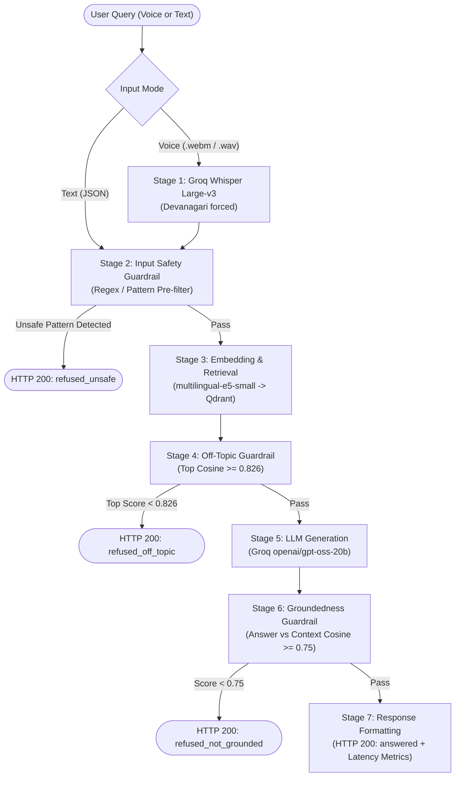

# Indic-RAG: Voice-Enabled Retrieval-Augmented Generation for Hindi

[](https://www.python.org/)
[](https://pytorch.org/)
[](https://qdrant.tech/)
[](https://groq.com/)
[](LICENSE)

An open-source, low-latency Voice Retrieval-Augmented Generation (Voice-RAG) pipeline optimized for the Hindi language. Indic-RAG integrates automatic speech recognition (ASR), dense multilingual semantic search, defensive safety and grounding guardrails, and rapid LLM inference into a unified API and interactive web interface.

Originally prototyped at Hacker House Goa 2026, the pipeline has been rigorously evaluated on standardized Indic benchmarks (MS MARCO-XI and FLEURS) to provide transparent, empirically verified performance metrics.

---

## Table of Contents

- [Problem Statement](#problem-statement)
- [Key Features](#key-features)
- [System Architecture](#system-architecture)
- [Technology Stack](#technology-stack)
- [How the RAG Pipeline Works](#how-the-rag-pipeline-works)
- [Retrieval and Evaluation Methodology](#retrieval-and-evaluation-methodology)
- [Benchmark Results](#benchmark-results)
  - [Dense Retrieval vs. Baselines](#dense-retrieval-vs-baselines)
  - [Cross-Lingual Retrieval](#cross-lingual-retrieval)
  - [Embedding Model Selection Trade-offs](#embedding-model-selection-trade-offs)
- [Speech Recognition Evaluation](#speech-recognition-evaluation)
- [API Performance and Latency](#api-performance-and-latency)
- [Answer Grounding and LLM Evaluation](#answer-grounding-and-llm-evaluation)
- [Installation and Setup](#installation-and-setup)
- [Environment Variables](#environment-variables)
- [Running the Application](#running-the-application)
- [API Endpoints and Example Requests](#api-endpoints-and-example-requests)
- [Project Structure](#project-structure)
- [Limitations and Future Work](#limitations-and-future-work)

---

## Problem Statement

Building production-grade Voice RAG systems for Indic languages introduces unique technical hurdles:

1. **Morphological Richness and Lexical Search Failure:** Standard keyword search algorithms like BM25 struggle with Hindi's complex inflectional morphology, resulting in poor retrieval recall.
2. **Cross-Lingual Asymmetry:** Users frequently ask questions in English or Hinglish while expecting answers sourced from native Hindi knowledge bases, requiring robust semantic alignment across scripts.
3. **Voice Latency Bottlenecks:** Chaining ASR, embedding models, vector databases, and generative models often introduces unacceptable latency for voice agents.
4. **Hallucination and Injection Risks:** Low-resource language models are susceptible to hallucinating unsupported facts or being misled by malicious prompt injections hidden inside retrieved contexts.

Indic-RAG addresses these challenges using multilingual sentence embeddings, fine-tuned speech transcription, defensive filtering guardrails, and streamlined inference serving.

---

## Key Features

- **Voice and Text Interfaces:** Native voice transcription via Whisper Large-v3 with enforced Devanagari script formatting, alongside structured JSON text endpoints.
- **Dense Multilingual Retrieval:** Powered by `intfloat/multilingual-e5-small`, achieving strong semantic matching for both native Hindi and cross-lingual English-to-Hindi queries.
- **Three-Tier Defensive Guardrails:**
  - *Layer 1 (Input Safety):* Regex and keyword pre-filter blocking prompt injections and adversarial overrides before any external API invocation.
  - *Layer 2 (Off-Topic Filtering):* Calibrated vector cosine threshold check (threshold `0.826`) that halts execution if retrieved knowledge is irrelevant, preventing unnecessary LLM expenditure.
  - *Layer 3 (Answer Grounding):* Semantic verification check (threshold `0.75`) comparing generated answers against retrieved passages to detect ungrounded responses.
- **Extensible Component Architecture:** Abstract interfaces (`VectorStore`, `LLMBackend`, `STT`) enabling plug-and-play replacement of providers (e.g., local Qdrant, Qdrant Cloud, Ollama, Groq, Sarvam).
- **Comprehensive Latency Telemetry:** Detailed timing capture across every pipeline stage (ASR, embedding, retrieval, guardrails, generation, and Time-To-First-Token).

---

## System Architecture

The following diagram illustrates the request lifecycle through the pipeline, highlighting the deterministic early-exit refusal paths:



---

## Technology Stack

| Layer | Technology | Model / Specification | Purpose & Justification |
| :--- | :--- | :--- | :--- |
| **Speech-to-Text (ASR)** | Groq Cloud API | `whisper-large-v3` (`language="hi"`) | Fast transcription (~636 ms median); prompts enforce Devanagari script output. |
| **Text Embeddings** | PyTorch / `sentence-transformers` | `intfloat/multilingual-e5-small` (118M params) | 384-dimensional dense vectors; matches base models at a fraction of compute cost. |
| **Vector Database** | Qdrant | Local embedded SQLite / Qdrant Cloud | HNSW indexing with exact cosine similarity matching. |
| **Generative LLM** | Groq Cloud API | `openai/gpt-oss-20b` | Fast inference with `reasoning_effort="low"` and streaming TTFT capture. |
| **Guardrails & Filtering** | Custom Python Engine | Regex rules + E5 Cosine Sim | Multi-stage safety checks blocking injections, irrelevant inputs, and hallucinations. |
| **API & Web Server** | Flask 3.1 + Flask-CORS | Python 3.12 runtime | Lightweight REST server exposing audio and text endpoints. |
| **Frontend** | Vanilla JS / CSS | Glassmorphism UI | Real-time audio recording via MediaRecorder API and per-stage latency telemetry display. |

---

## How the RAG Pipeline Works

The execution flow consists of 7 discrete stages:

1. **Speech-to-Text (`GroqSTT`):** If an audio file is uploaded, it is sent to Groq's Whisper Large-v3 endpoint with `language="hi"`. The transcription prompt instructs the model to preserve Devanagari script and avoid transliteration into Latin or Urdu characters.
2. **Input Safety Verification (`check_input_safety`):** Queries are normalized and checked against compiled regex patterns designed to catch prompt overrides, role-playing jailbreaks (e.g., DAN, "ignore instructions"), and malicious content before any downstream model is invoked. If triggered, execution halts immediately with `refused_unsafe`.
3. **Query Embedding and Retrieval (`QdrantVectorStore`):** The query text is prefixed with `query: ` and encoded using `multilingual-e5-small`. Qdrant searches the vector index for the top-$k$ nearest passage chunks ($k=2$ in production configuration) using cosine similarity.
4. **Off-Topic Gating (`check_off_topic`):** The top chunk similarity score is evaluated against an empirical threshold of `0.826` (calibrated against the 99th percentile of out-of-domain queries). If the score falls below this value, the pipeline concludes that the knowledge base cannot answer the query and halts with `refused_off_topic`, saving LLM token costs.
5. **Contextual LLM Generation (`GroqLLMBackend`):** The retrieved chunks are encapsulated within XML delimiters (`<context>...</context>`). A security instruction directs the LLM to treat the context strictly as data (hardening against indirect prompt injection). The LLM (`openai/gpt-oss-20b`) generates a concise answer in the query's language.
6. **Groundedness Verification (`check_groundedness`):** The generated answer is embedded and its cosine similarity against the retrieved context passages is calculated. If the similarity is below `0.75`, the response is flagged as potentially ungrounded or hallucinatory, returning `refused_not_grounded`.
7. **Response Envelope:** A standardized JSON response is returned containing the status, transcript, final answer, similarity scores, and per-stage latency percentiles.

---

## Retrieval and Evaluation Methodology

To establish credible, statistically valid baselines, retrieval performance was evaluated using standard information retrieval protocols on a held-out dataset.

- **Corpus & Split:** 2,159 test queries from the **MS MARCO-XI Hindi validation split** (`hinval.parquet`), completely disjoint from any training sample.
- **Corpus Size:** 50,493 text chunks derived from 49,620 passages pooled across 5,000 queries (seed 7) and chunked using the production `RecursiveChunker`.
- **Fairness & Consistency:** All candidate embedding models and baselines were evaluated on the exact same chunks and queries. Dense retrieval used exact cosine distance (identical to Qdrant local embedded execution).
- **Metrics Defined:**
  - **Recall@5 (Hit-Rate@5):** Percentage of queries where at least one ground-truth relevant chunk is present in the top-5 retrieved items.
  - **MRR@5:** Mean Reciprocal Rank of the first relevant chunk within the top-5 positions.
- **Statistical Tests:** 95% bootstrap confidence intervals (2,000 iterations); paired McNemar tests for statistical significance on top-5 retrieval success.

---

## Benchmark Results

### Dense Retrieval vs. Baselines

Evaluated on the 2,159 held-out Hindi test queries over 50,493 chunks:

| System | Parameters / Dimensions | Recall@5 (Hit@5) | MRR@5 | Δ Recall@5 vs. E5-Small | Significance ($p$-value) |
| :--- | :---: | :---: | :---: | :---: | :---: |
| **`multilingual-e5-small` (Selected)** | **118M / 384-d** | **70.3%** | **46.1%** | — | — |
| `multilingual-e5-base` | 278M / 768-d | 70.5% | 47.1% | +0.2 pp | $p = 0.79$ (Not Significant) |
| BM25 (Hindi Tokenized) | Lexical Index | 42.5% | 26.0% | −27.8 pp | $p < 0.001$ |
| Hybrid BM25 + E5-Small (RRF) | Dense + Lexical Fusion | 59.6% | 37.2% | −10.7 pp | $p < 0.001$ |
| `paraphrase-multilingual-MiniLM-L12` | 118M / 384-d | 38.2% | 23.5% | −32.1 pp | $p < 0.001$ |
| `all-MiniLM-L6-v2` (English Baseline) | 22M / 384-d | 1.2% | 0.8% | −69.2 pp | $p < 0.001$ |

> **Key Takeaway:** Dense semantic retrieval with `multilingual-e5-small` outperforms the lexical BM25 baseline by **+27.8 percentage points** in Recall@5 ($p < 0.001$). 

### Cross-Lingual Retrieval

To assess cross-lingual capabilities, the same 2,159 queries were presented in their original English form to retrieve the corresponding Hindi documents:

| System | English Query $\to$ Hindi Docs Recall@5 | MRR@5 |
| :--- | :---: | :---: |
| **`multilingual-e5-small`** | **67.9%** | **45.0%** |
| `multilingual-e5-base` | 67.1% | 45.1% |
| Hybrid BM25 + E5-Small (RRF) | 49.8% | 29.9% |
| `paraphrase-multilingual-MiniLM-L12` | 47.1% | 30.4% |
| BM25 (Lexical) | 0.5% | 0.4% |
| `all-MiniLM-L6-v2` (English Baseline) | 0.8% | 0.7% |

Across script boundaries (Latin to Devanagari), `multilingual-e5-small` retains 67.9% Recall@5, whereas lexical search completely fails due to disjoint vocabularies.

### Embedding Model Selection Trade-offs

- **Parameter Efficiency:** `multilingual-e5-base` contains 278 million parameters (~2.4× the size of `e5-small`). On the 2,159-query held-out benchmark, `e5-base` achieved 70.5% Recall@5 compared to 70.3% for `e5-small`—a marginal gain of 0.2 percentage points that was not statistically significant ($p = 0.79$). The smaller model was selected to maximize CPU inference throughput and minimize memory footprint.
- **Why Hybrid BM25 Did Not Help:** Lexical BM25 retrieved a relevant passage missed by `e5-small` in only 2.6% of queries. Because BM25 performance is significantly lower on Hindi (42.5%), combining rankings via Reciprocal Rank Fusion (RRF) introduced noise that degraded top-5 accuracy relative to dense search alone.

---

## Speech Recognition Evaluation

The speech recognition module (`GroqSTT` using `whisper-large-v3`) was evaluated on the complete **FLEURS Hindi (`hi_in`) test set**:

| Metric | Measured Value | 95% Confidence Interval | Notes / Conditions |
| :--- | :---: | :---: | :--- |
| **Word Error Rate (WER)** | **29.6%** | 27.6% – 31.6% | Measured across 418 test audio clips (80.5 total minutes) |
| **Character Error Rate (CER)** | **14.5%** | 12.6% – 16.8% | Character-level accuracy is less sensitive to compounding words |
| **Median STT Latency** | **636 ms** | — | Mean latency: 713 ms; Real-Time Factor (RTF): 0.06 |
| **Devanagari Script Rate** | **95.2%** | — | Percentage of output characters matching Unicode Devanagari block |

**Evaluation Notes:**
- References and model outputs underwent standard NFC Unicode normalization, lowercasing, and stripping of punctuation and danda (`।`). No numeral-to-word transliteration was applied.
- WER reflects read Wikipedia sentences from FLEURS. Everyday conversational or heavily code-mixed (Hinglish) speech was not part of this benchmark.

---

## API Performance and Latency

API latency was benchmarked using the production Flask service (`api.py`) on an AMD Ryzen 7 7445HS (6 cores / 12 threads) running on CPU.

### Test Configuration
- **Requests Evaluated:** 100 sequential HTTP requests (90 answerable knowledge queries + 10 off-topic queries).
- **Environment:** Local embedded Qdrant SQLite storage and live Groq API inference. Requests were paced at 1 per 8 seconds to operate comfortably within free-tier API rate limits.
- **Scope:** Evaluates the **text query API path** (`/api/query/text`). It does not include client network hops or speech recognition latency (STT was evaluated separately above).

### Latency Distribution

| Stage / Metric | Median (P50) | P95 | Min | Max | HTTP Success Rate |
| :--- | :---: | :---: | :---: | :---: | :---: |
| **Client-Side Round-Trip (All Requests)** | **734 ms** | **1,042 ms** | **64 ms** | **1,616 ms** | **100/100 (100%)** |
| Client-Side Round-Trip (Answered Only) | 750 ms | — | 319 ms | 1,616 ms | 91/91 (100%) |
| Client-Side Round-Trip (Off-Topic Refusals) | 67 ms | — | 64 ms | 107 ms | 5/5 (100%) |

### Component Latency Breakdown (Server Internal Profiling)

| Pipeline Stage | Median Latency | Purpose |
| :--- | :---: | :--- |
| **Input Safety Guardrail** | < 1 ms | Regex pattern scan |
| **Query Embedding** | 97 ms | `multilingual-e5-small` inference on CPU |
| **Vector Retrieval** | 63 ms | Qdrant local cosine search over index |
| **Off-Topic Guardrail** | < 1 ms | Threshold comparison against top score |
| **LLM Answer Generation** | 507 ms | Groq `openai/gpt-oss-20b` (TTFT + streaming) |
| **Groundedness Verification** | 159 ms | Cosine similarity check of generated answer |

> **Important Operational Note:** These figures reflect single-client local testing against local embedded Qdrant. Under high concurrent load or when connecting to Qdrant Cloud across WAN connections, latencies will vary based on network round-trip times.

---

## Answer Grounding and LLM Evaluation

Generated responses were audited for factual grounding against their retrieved contexts using an LLM-as-a-judge evaluation protocol.

- **Sample Size:** 82 production answers generated for held-out queries (excluding explicit refusals).
- **Judge Model:** `openai/gpt-oss-120b` (`reasoning_effort="low"`).
- **Criterion:** Whether all factual claims in the answer are directly substantiated by the retrieved text passage.

### Grounding Evaluation Results

| Judge Verdict | Distribution | 95% Confidence Interval | Meaning |
| :--- | :---: | :---: | :--- |
| **Fully Supported (Grounded)** | **86.6%** (71 / 82) | 78.0% – 93.9% | All factual claims derived from retrieved context |
| **Partially Supported** | **6.1%** (5 / 82) | — | Mixture of grounded statements and minor assumptions |
| **Not Supported** | **7.3%** (6 / 82) | — | Answer contradicts context or hallucinates external data |

*Note: The 86.6% groundedness rate measures context adherence, not overall domain accuracy.*

### Token Budget Analysis (Experimental Finding)

In the default production deployment, `max_completion_tokens` is configured to `150` to maintain fast response times:
- Because the reasoning model reserves tokens for hidden chain-of-thought (~47 tokens on average), **31% of production answers were truncated** by this tight token budget.
- In an offline A/B benchmark evaluating 100 queries with the completion limit expanded to **1,024 tokens**, complete answers rose from **53.5% to 85.9%** without a statistically significant latency increase (median 538 ms vs. 542 ms, $p = 0.28$). This remains an evaluated improvement slated for upcoming configuration updates.

---

## Installation and Setup

### Prerequisites

- **Python:** Version 3.12 or higher recommended.
- **Git:** Version 2.30+.
- **Hardware:** Modern multi-core CPU; 8+ GB RAM.

### Step 1: Clone Repository

```bash
git clone https://github.com/AryanShaikh-dev/Indic-RAG.git
cd Indic-RAG
```

### Step 2: Set Up Virtual Environment

Using standard Python virtual environments:

```bash
python -m venv .venv

# On Linux / macOS
source .venv/bin/activate

# On Windows (PowerShell)
.venv\Scripts\Activate.ps1
```

Or using `uv` (recommended for fast dependency resolution):

```bash
uv venv .venv
source .venv/bin/activate  # Or .venv\Scripts\activate on Windows
```

### Step 3: Install Dependencies

To ensure compatibility with Groq's `reasoning_effort` API and modern Qdrant client interfaces:

```bash
pip install -e .
```

> **Deployment Note Regarding Docker:** The repository includes a `Dockerfile` and legacy `requirements.txt`. An audit revealed dependency version conflicts between pinned legacy packages (`groq==0.8.0`, `qdrant-client==1.9.1`) and the current API code. Containerized deployments should use `pyproject.toml` dependencies with Python 3.12 until the standalone Dockerfile is updated.

---

## Environment Variables

Create a `.env` file in the project root:

```bash
cp .env.example .env
```

Configure the following variables:

| Variable | Required | Default | Description |
| :--- | :---: | :---: | :--- |
| `GROQ_API_KEY` | **Yes** | — | API key for Groq Cloud (powers Whisper STT and GPT-OSS generation). |
| `PORT` | No | `7860` | Port for the Flask web application. |
| `QDRANT_URL` | No | `None` | Optional Qdrant Cloud cluster URL. If omitted, local SQLite storage is used. |
| `QDRANT_API` | No | `None` | Optional API key for Qdrant Cloud. |
| `SARVAM_API_KEY` | No | `None` | Optional alternative STT provider (Sarvam AI). |
| `ELEVENLABS_API_KEY` | No | `None` | Optional alternative STT provider (ElevenLabs Scribe). |

---

## Running the Application

### 1. Launch the Web Interface and API Server

Start the Flask application:

```bash
python api.py
```

Open your browser at **`http://localhost:7860`** to access the glassmorphism voice and text interface.

### 2. Run the CLI Test Harness

To test a recorded audio clip directly from the command line:

```bash
python main.py sample_record.wav
```

---

## API Endpoints and Example Requests

The API exposes two primary endpoints returning identical JSON response structures.

### 1. Text Query Endpoint

- **Route:** `POST /api/query/text`
- **Content-Type:** `application/json`

```bash
curl -X POST http://localhost:7860/api/query/text \
  -H "Content-Type: application/json" \
  -d '{"query": "ताजमहल कहाँ स्थित है?"}'
```

### 2. Audio Query Endpoint

- **Route:** `POST /api/query/audio`
- **Content-Type:** `multipart/form-data`

```bash
curl -X POST http://localhost:7860/api/query/audio \
  -F "audio=@recording.wav"
```

### Response Schema

```json
{
  "status": "answered",
  "transcript": "ताजमहल कहाँ स्थित है?",
  "answer": "ताजमहल भारत के उत्तर प्रदेश राज्य के आगरा शहर में यमुना नदी के तट पर स्थित है।",
  "guardrail_scores": {
    "top_similarity": 0.884,
    "groundedness": 0.912
  },
  "latency": {
    "stt": 635.5,
    "embedding": 96.6,
    "retrieval": 62.9,
    "generation": 506.7,
    "guardrail_input": 0.1,
    "guardrail_off_topic": 0.2,
    "guardrail_groundedness": 159.1,
    "end_to_end": 735.0
  },
  "error_detail": null
}
```

**Status Values:**
- `answered`: Query successfully processed, retrieved, and verified.
- `refused_unsafe`: Input pattern matched prompt injection or safety guardrail.
- `refused_off_topic`: Top retrieved chunk cosine similarity fell below `0.826`.
- `refused_not_grounded`: Generated answer cosine similarity fell below `0.75`.
- `error`: Network or inference exception encountered during execution.

---

## Project Structure

```text
Indic-RAG/
├── api.py                   # Production Flask application and route handlers
├── main.py                  # Command-line interface for testing voice queries
├── pyproject.toml           # Modern package configuration and dependencies
├── requirements.txt         # Pinned legacy dependencies (see deployment notes)
├── Dockerfile               # Container definition
├── frontend/                # Interactive browser UI
│   ├── index.html           # Terminal and metric card layout
│   ├── styles.css           # Glassmorphism styling and responsive layout
│   └── app.js               # Audio recording (MediaRecorder) and API communication
├── src/
│   └── core/                # Core modular RAG pipeline
│       ├── interfaces.py    # Abstract base classes (VectorStore, LLMBackend)
│       ├── orchestrator.py  # Pipeline controller and retry management
│       ├── embeddings.py    # SentenceTransformers wrapper with E5 prefixes
│       ├── vectorstore.py   # Qdrant vector store implementation (Local/Cloud)
│       ├── stt.py           # Speech-to-text clients (Groq Whisper, Sarvam, ElevenLabs)
│       ├── llm.py           # LLM clients (Groq GPT-OSS, Ollama)
│       ├── guardrails.py    # Input safety, off-topic, and grounding verification
│       ├── chunking.py      # Recursive and sentence text splitters
│       └── latency.py       # Millisecond telemetry and percentile tracking
├── scripts/                 # Ingestion and benchmark utilities
│   ├── ingest_hindi.py      # MS MARCO-XI parquet processing and indexing
│   └── migrate_to_qdrant_cloud.py  # Local-to-cloud migration script
└── audit/                   # Verified evaluation suite and benchmark logs
    ├── RESUME_METRICS_REPORT.md  # Comprehensive verified metrics report
    ├── IMPROVEMENT_ROADMAP.md   # Prioritized technical debt and improvement plan
    ├── results/             # Raw JSON and CSV data for all audit benchmarks
    └── scripts/             # Reproducible evaluation scripts
```

---

## Limitations and Future Work

To maintain technical rigor, the following design boundaries and ongoing investigations are explicitly disclosed:

1. **Context Window Cap ($k=2$):** In the evaluated production configuration, the orchestrator passes only the top-2 retrieved chunks to the LLM. While Hit@20 across the corpus reaches 89.6%, Hit@2 is 46.1%. Implementing a two-stage retrieval pipeline with a multilingual cross-encoder reranker (e.g., `bge-reranker-v2-m3`) is planned to feed top-ranked contexts without inflating prompt sizes.
2. **Evaluation Corpus Domain:** Benchmarking was conducted using translated Wikipedia and query passages from MS MARCO-XI. Open-domain performance across domain-specific legal, medical, or conversational corpora may yield different baseline scores.
3. **Conversational Speech Nuances:** The STT benchmark (29.6% WER) was evaluated on read speech from FLEURS. Real-world Hindi often involves conversational code-switching (Hinglish), which requires targeted acoustic fine-tuning.
4. **Guardrail Script Coverage:** The current Layer 1 input safety pre-filter uses English regex patterns. Devanagari script adversarial jailbreaks currently rely on the LLM's system prompt instructions rather than deterministic keyword blocking.
5. **Container Dependency Unification:** Updating the container build to align pinned package versions with Python 3.12 will ensure seamless automated deployment on container platforms like HuggingFace Spaces.
